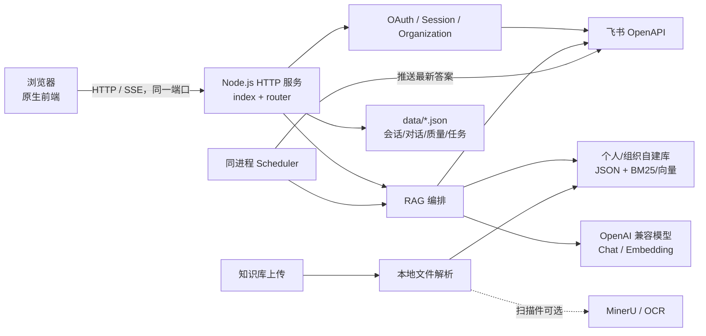

# 飞书大脑（Feishu Brain）

飞书大脑是一个面向个人和团队内部使用的飞书知识问答 Web 应用：使用当前登录人的飞书权限实时检索资料，并结合自建知识库与大模型生成带证据的回答。

它适合已经使用飞书、希望统一检索文档/知识库/表格/聊天记录，并需要保留引用和质量反馈的个人或小团队。当前实现是单机技术基线，不是已经完成高可用、审计和容量验证的商用 SaaS。

明文 `.env` 不应提交到 Git；公开仓库只提供不含真实密钥的 `.env.example`。

## 核心能力

- **按本人权限检索飞书资料**：通过飞书 OAuth 获取用户身份，搜索云盘、Wiki、飞书文档、飞书表格和消息；最终能读取的内容仍受飞书权限控制。
- **三路召回与证据筛选**：飞书资料、个人/组织自建知识库、飞书消息并行召回，再经过词法/向量排序、模型相关性判断和自适应证据选择。
- **有证据时展示引用**：回答正文和参考资料关联；飞书 Docx 尽力定位到块，聊天链接尽力定位到消息。通用回答、联网回答或没有合格证据时不保证有引用。
- **个人与组织知识库**：支持文本、Markdown、CSV、JSON、日志、Docx、Xlsx、Pptx 和文本型 PDF；扫描件需要可选的 MinerU 或 OCR 服务。
- **模型可配置**：内置智谱、Kimi、阿里云百炼和 Agnes 的 OpenAI 兼容预设，也支持自定义 Base URL 与模型名。用户可在右上角设置自己的 API Key。
- **分享与跟踪**：答案可导出为飞书文档或以本人身份转发；定时任务会按设定时间重新执行问答并推送最新结果。
- **组织角色和质量闭环**：以 `tenant_key` 区分组织，提供 Owner/Admin/Member 角色、个人/组织看板、反馈、质量案例和检索轨迹。

> 数据边界：系统不会为飞书全文建立一份离线原文索引，但会在本地保存会话、OAuth token、对话、引用片段、质量轨迹、任务和向量缓存。入选的证据文本会发送给用户选择的模型/Embedding 服务。部署前应完成组织的数据合规评估。

## 服务与模块

| 模块 | 职责 | 主要依赖 |
|---|---|---|
| `public/` | 原生 HTML/CSS/JavaScript 页面，通过同源 `/api/*` 调用后端 | 浏览器 |
| `server/index.js`、`router.js` | 唯一 HTTP 进程；提供静态页面、OAuth、JSON API、SSE 问答，并启动调度器 | Node.js |
| `auth.js`、`session.js`、`organization.js` | 飞书 OAuth、token 刷新、会话持久化和租户角色 | 飞书开放平台、本地 JSON |
| `rag.js`、`query-planner.js`、`evidence.js` | 查询规划、并行召回、排序、证据选择和流式回答编排 | 飞书、自建库、模型服务 |
| `feishu.js` | 飞书文档/Wiki/Sheets/消息检索、导出和转发 | 飞书 OpenAPI |
| `kb.js`、`semantic.js`、`parse.js` | 自建知识库、BM25/向量融合、文件解析 | 本地 JSON、`pdfjs-dist` |
| `providers.js`、`llm.js` | 模型预设、OpenAI 兼容聊天与 Embedding 调用 | 外部模型 API |
| `tasks.js`、`scheduler.js`、`feishubot.js` | 每 30 秒轮询到期任务、重新问答并推送 | 持久化飞书登录态、机器人权限 |
| `analytics.js`、`quality.js` | 提问统计、反馈、质量案例与指标 | 本地 JSON |
| `mineru.js` | 调用可选的本机 MinerU 服务；仓库不包含 MinerU 本体 | 默认 `127.0.0.1:18000` |

## 系统架构



## 技术架构

| 层次 | 实际实现 |
|---|---|
| 前端 | 原生 HTML/CSS/JavaScript，无前端框架和构建步骤 |
| 后端 | Node.js CommonJS、原生 `http`，最低 Node.js 18 |
| 运行模型 | 单进程、单端口；前后端和调度器共用同一进程 |
| 持久化 | `data/*.json` 与 `data/kb/*.json`；没有数据库、Redis 或消息队列 |
| 文档解析 | Node 内置 ZIP/XML 解析；`pdfjs-dist 4.2.67` 解析文本型 PDF |
| 外部服务 | 飞书 OpenAPI、OpenAI 兼容模型；MinerU/OCR 可选 |
| 容器 | `node:20-alpine`，Docker Compose 仅启动本应用 |
| 测试 | Node `assert` + 独立测试脚本；没有 lint 或前端 build 命令 |

## 项目目录

```text
feishu-brain/
├── public/                 # 页面、样式、浏览器端逻辑与静态资源
├── server/                 # HTTP、OAuth、RAG、飞书适配、存储与调度
├── script/sh/              # 统一的一键启动、停止、状态与 MinerU 包装脚本
├── scripts/                # 测试编排工具
├── test/                   # 离线单元/集成测试及需真实环境的 UI 验证脚本
├── data/                   # 运行时 JSON 数据（首次按需创建，Git 忽略）
├── logs/                   # 运行日志（脚本创建，Git 忽略）
├── .run/                   # PID、运行模式和依赖指纹（脚本创建，Git 忽略）
├── .env.example            # 不含真实密钥的配置模板
├── docker-compose.yml
├── Dockerfile
└── package.json
```

## 快速开始

### 环境要求

- Git。
- Node.js 18 或更高版本、npm。`start-all.sh` 会先复用满足要求的现有安装；缺失时会在支持的 macOS/Homebrew 或 Linux 包管理器上尝试安装，无法自动安装时给出明确地址或命令。
- 一个飞书企业自建应用以及可登录该企业的飞书账号。
- 大模型 API Key。可以设置部署级默认 Key，也可以登录后在右上角按用户填写。
- Docker **不是原生启动的依赖**；只有显式使用 `--docker` 时才需要。

### 1. 克隆并配置

```bash
git clone https://github.com/wenpeifeng/feishu-brain.git
cd feishu-brain
cp .env.example .env
```

在[飞书开放平台开发者后台](https://open.feishu.cn/app)创建企业自建应用，把 `FEISHU_APP_ID` 和 `FEISHU_APP_SECRET` 写入 `.env`，并把重定向 URL 配为：

```text
http://127.0.0.1:3000/api/auth/feishu/callback
```

根据应用实际使用范围开通文档、Wiki、Sheets、消息、通讯录、创建文档和以用户身份发消息等权限。代码默认申请的用户 scope 在 `server/auth.js` 中维护，也可通过 `FEISHU_SCOPES` 覆盖。

### 2. 一键启停

```bash
# 启动或用当前代码重启受管实例
./script/sh/start-all.sh

# 检查应用、PID、端口、健康状态、Docker、可选 MinerU 和日志
./script/sh/status-all.sh

# 只停止当前项目脚本管理的进程；不会删除 data/ 或 Docker 数据
./script/sh/stop-all.sh
```

首次启动、依赖缺失、依赖校验失败或 `package-lock.json` 变化时脚本执行 `npm ci`；其余启动跳过依赖安装。日志写入 `logs/feishu-brain.log`，运行标识写入 `.run/`。如果端口被未受管程序占用，脚本只报告占用 PID，不会误杀。

### 3. 可选 Docker 模式

```bash
./script/sh/start-all.sh --docker
./script/sh/status-all.sh
./script/sh/stop-all.sh
```

Docker 模式会把 `.env` 注入容器，把 `data/` 挂载到宿主机，并等待 `/api/health`。宿主机端口由 `FEISHU_BRAIN_HOST_PORT` 控制；默认 3000。脚本停止容器但不删除数据或 Volume。

## 访问入口

默认本机地址如下；修改 `HOST`/`PORT` 后以启动脚本输出为准。

| 入口 | 地址 | 说明 |
|---|---|---|
| Web 应用 | `http://127.0.0.1:3000/` | 主界面 |
| 登录页 | `http://127.0.0.1:3000/login.html` | 飞书 OAuth 登录 |
| 健康检查 | `http://127.0.0.1:3000/api/health` | 无鉴权，不返回配置或密钥 |
| API | `http://127.0.0.1:3000/api/*` | 与前端同端口，受保护接口使用 Bearer session |

项目没有用户名/密码登录体系、内置演示账号、Swagger 或 OpenAPI 文档页面，因此不提供虚构的账号和 API 文档入口。

## 配置说明

完整模板见 [.env.example](.env.example)。模板只放空值和安全默认值，不提交真实密钥。

| 变量 | 默认/示例 | 作用 |
|---|---|---|
| `HOST` / `PORT` | `127.0.0.1` / `3000` | 原生模式监听地址和端口 |
| `APP_BASE_URL` | `http://127.0.0.1:3000` | OAuth 回调和机器人登录提示的基础地址；必须与飞书后台一致 |
| `FEISHU_APP_ID` / `FEISHU_APP_SECRET` | 无 | 飞书 OAuth 必填；启动脚本只检查是否存在，不打印内容 |
| `FEISHU_REDIRECT_PATH` | `/api/auth/feishu/callback` | OAuth 回调路径 |
| `FEISHU_SCOPES` | 代码内置 scope | 可选，自定义 OAuth scope |
| `FEISHU_VERIFICATION_TOKEN` / `FEISHU_ENCRYPT_KEY` | 无 | 飞书事件订阅/机器人加密消息使用 |
| `FEISHU_TENANT_KEY` / `ADMIN_OPEN_IDS` | 无 | 旧会话租户兜底与首次角色迁移 |
| `DEFAULT_LLM_PROVIDER` | 示例为 `bailian` | 部署级默认模型厂商 |
| `DEFAULT_LLM_KEY` | 空 | 可选服务端兜底 Key；对外部署建议留空 |
| `MINERU_ENABLED` | `false` | 是否调用外部本机 MinerU 服务 |
| `OCR_API_URL` / `OCR_API_KEY` | 空 | 可选的图片/扫描件 OCR 服务 |
| `LLM_DECISION_CACHE_TTL_MS` | `0` | 查询规划/法官决策缓存时长；0 为关闭 |
| `FEISHU_BRAIN_HOST_PORT` | `3000` | Docker 暴露到宿主机的端口 |

页面右上角的模型设置支持填写 `Base URL`、模型名和 `API Key`。预设会提供默认 URL/模型，但不会内置厂商密钥；自定义模型通常也需要这三项。用户 API Key 只保留在服务端当前会话内存并且不会回显，但飞书 access/refresh token 会持久化到 `data/sessions.json`。

本项目不使用数据库，也没有迁移或种子数据。`data/` 会在首次使用相应功能时按需创建；重复启动、停止和 Docker 重建不会主动清空已有业务数据。

## 项目难点与解决方案

| 难点 | 实际方案 | 效果与边界 |
|---|---|---|
| 不复制一套容易失真的权限 | 使用当前用户的飞书 OAuth token 实时读取 | 权限由飞书读取接口强制；仍需正确配置应用 scope |
| 多来源结果噪声和专名误差 | 文档/消息/自建库并行召回，结合查询规划、词法/向量排序和模型法官 | 提升可用证据质量；结果仍受飞书搜索候选和模型稳定性影响 |
| 答案需要核查 | 保留证据编号，Docx 尽力生成块锚点，消息尽力生成定位链接 | 有入选证据时可回查；不是每种回答或每种文件都能精确锚定 |
| Office/PDF 上传依赖重 | Office 用内置 ZIP/XML 解析，文本 PDF 只引入 `pdfjs-dist`，扫描件外接 MinerU/OCR | 默认依赖少；复杂版式和扫描件质量取决于可选解析服务 |
| 新环境避免误带凭证 | 公开仓库只提交 `.env.example`，首次启动生成本地 `.env` | 降低明文凭证误提交风险；新环境仍需自行申请并填写凭证 |
| 启停误杀和依赖重复安装 | PID + 命令/cwd 校验、端口所有者检查、锁文件哈希、健康检查 | 只管理本项目启动的进程；陌生端口占用时失败而不是杀进程 |

## 核心亮点

- 单个 Node 进程同时提供前端、API、SSE 和调度器，开发和单机部署路径短。
- 飞书实时检索与本地自建库并存，分别保留权限边界和可控索引能力。
- 模型端点/模型名可覆盖；不支持 Embedding 的厂商会降级到词法排序。
- 从检索候选、证据、反馈到质量案例形成可追溯链路，而不是只保存最终答案。
- 生命周期脚本幂等、安全失败，不会用 `killall`、`pkill` 或端口通杀命令误伤其他服务。

## 开发与验证

```bash
# 前台开发运行；仍需有效 .env
npm run dev

# 快速 API 回归（当前运行 test/api.test.js）
npm test

# 在临时副本中顺序运行全部 test/*.test.js，避免污染真实 data/
npm run test:all

# Shell 语法检查
bash -n script/sh/*.sh

# 容器构建配置检查
docker compose config
docker compose build
```

项目没有独立的前端 build 和 lint 命令。离线测试覆盖 OAuth/会话、路由、组织权限、RAG、模型适配、自建库、文件解析、引用、缓存和质量记录。`test/` 中另有依赖真实飞书会话或浏览器调试环境的 UI/在线验收脚本，它们不属于默认离线回归。

## 常见问题

### 端口 3000 被占用

先运行 `./script/sh/status-all.sh`。若是本项目受管实例，用 `./script/sh/stop-all.sh`；若显示未受管 PID，请确认它属于什么程序后自行处理，或修改 `.env` 的 `PORT`。脚本不会自动杀死未知进程。

### Node.js 版本不满足或依赖安装失败

需要 Node.js 18+。脚本会尝试使用 Homebrew、apt、dnf 或 yum；无法自动安装时请从 [Node.js 官网](https://nodejs.org/)安装 LTS。锁文件中的镜像地址可能受网络环境影响，必要时先检查 npm 网络和 registry 配置。

### Docker 已安装但没有启动

只有 `--docker` 模式需要 Docker。macOS 脚本会尝试打开 Docker Desktop，Linux 会尝试启动 daemon；失败时按报错手动启动后重试。原生模式可完全不安装 Docker。

### 启动失败或状态不健康

查看：

```bash
tail -n 200 logs/feishu-brain.log
./script/sh/status-all.sh
```

常见原因是 `.env` 缺少飞书凭证、OAuth 回调不一致、端口冲突或外部模型不可用。健康检查只证明 HTTP 进程可响应，不代表飞书或模型供应商均可访问。

### MinerU 已启用但不可用

MinerU 不随本仓库安装。默认寻找项目同级的 `mineru-service/mineru-service.sh`，也可设置 `MINERU_SERVICE_DIR`。文本型 PDF 会降级到本地 PDF.js；扫描件可能仍需 MinerU 或 OCR。

### 登录后模型仍不可用

在右上角模型设置中检查 Base URL、模型名和 API Key 是否属于同一厂商。自定义 Base URL 时，系统不会把默认厂商 Key 发送到新的端点。

## 生产使用说明

- 默认 `HOST=127.0.0.1` 只适合本机。对外部署应使用 HTTPS 反向代理、防火墙、进程守护和访问日志，并评估当前 `Access-Control-Allow-Origin: *` 是否符合安全策略。
- 仓库不包含演示账号、默认密码或开发免登录桩。不要在 `.env.example`、Git 历史、截图或日志中放真实 App Secret/API Key。
- `data/` 含 OAuth token、对话、引用片段和质量数据；生产环境必须限制文件权限、加密备份，并建立凭证轮换与数据保留策略。
- 当前 JSON 文件存储适合单机，不适合多实例并发、横向扩容或高可用。需要商用部署时应先迁移到具备事务和并发控制的持久化方案，并补充限流、审计、监控和灾备。
- 飞书 Sheets 当前只读取有限的工作表/行列范围，复杂 Office/PDF 版式也可能降级；上线前应使用本组织的真实资料和权限矩阵验收。
- 证据文本会发送到所选 LLM/Embedding/OCR 服务。使用第三方服务前确认数据驻留、保密和供应商合规要求。
- 许可证为 [MIT](LICENSE)。欢迎通过 Issue 描述可复现问题，通过 Pull Request 提交小范围、带测试且不含敏感数据的改动。
