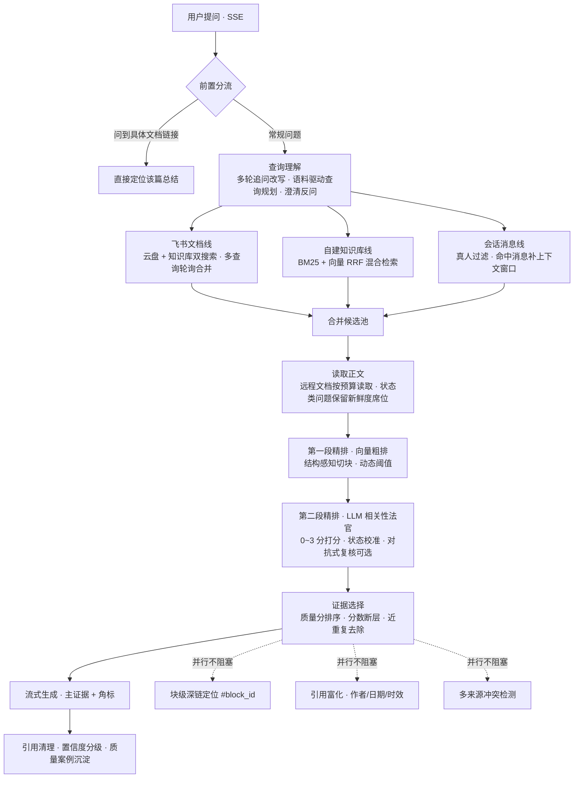

<div align="center">

# 飞书大脑 Feishu Brain

**基于飞书的实时权限 RAG 知识问答系统**

用飞书账号登录，按**你本人的权限**实时检索文档、表格与聊天记录，
叠加自建知识库混合检索 —— 每个答案都能溯源到具体文档块。

**你能看到的，它才能回答；它答出的每句话，都能点回原文。**

[快速开始](#-快速开始) · [检索管线](#-rag-检索管线) · [核心特性](#-核心特性) · [配置](#️-配置) · [已知限制](#️-已知限制坦诚边界)


</div>

---

## 为什么是飞书大脑？

企业知识通常困在三座孤岛里：**文档躺在知识库、结论沉在聊天记录、资料散在个人手里**。常见的知识库问答方案走「离线导入 → 切片入库 → 全量索引」路线，有三个绕不开的问题：

1. **权限被架空** —— 文档一旦进了索引，没有权限的人也能问出答案
2. **永远是旧版** —— 文档改了、群里拍了板，索引还停留在上周的快照
3. **答案不可信** —— 一段"综合了多份资料"的总结，找不到证据在哪一句

飞书大脑换了一条路：**不复制权限、不缓存答案，每次提问都用提问人本人的飞书身份实时检索**。

| | 离线索引型问答 | 飞书大脑 |
|---|---|---|
| 权限 | 索引时刻的快照，易越权 | 每次检索按提问人**实时权限**强制 |
| 新鲜度 | 取决于同步周期 | 实时（文档 / 表格 / 消息） |
| 溯源粒度 | 文档级 | **块级深链、消息级定位** |
| 数据出域 | 需全量导出入库 | 飞书侧数据不落地、不做离线索引 |

> [!TIP]
> 也支持把自有资料（PDF / Office / 扫描件）传进**自建知识库**做混合检索——自有数据建索引，飞书数据实时查，两边各用各的最优解。

<!-- TODO: 补一张主界面截图 / 演示 GIF（回答 + 参考资料 + 块级深链跳转） -->

## ✨ 核心特性

### 🔐 权限与多租户

- **飞书 OAuth 登录**，全程使用提问人本人的 `user_access_token` 检索——权限在读取步骤被飞书天然强制，系统**不做任何权限复制**
- **组织模型**：以 `tenant_key` 为租户边界；个人知识库仅本人可读写（管理员也不能读）；组织知识库同租户共享，Owner / 管理员 / 成员三级角色
- **数据隔离**：对话按人全链路 IDOR 校验；API Key 只存服务端会话内存，不落盘、绝不下发前端
- OAuth state HMAC-SHA256 签名防 CSRF；token 到期前自动刷新

### 🧠 十级 RAG 检索管线

每一级都为「企业事实问答」专门设计，不是通用 RAG 模板的套用：

- **查询理解**：多轮追问改写（检索用改写、展示用原话）；**语料驱动查询规划**——从用户真实可见的标题中发现"一字之差"的近似实体补搜，而不是让模型猜专名；笼统问题先澄清反问
- **三路并行召回**：飞书文档线（云盘 + 知识库双搜索、多查询轮询合并）＋自建知识库线（BM25 + 向量 RRF 融合）＋会话消息线（真人过滤、命中消息补上下文窗口）
- **两段式精排**：向量粗排（结构感知切块：Q&A / 小节独立成块）→ **LLM 相关性法官**（0~3 分 + rank，分批并行、决策缓存、可对抗式复核）
- **状态校准**：状态类问题"局部材料缺失 ≠ 整体状态"降权、原文含明确状态的确定性保护
- **证据自适应**：法官通过 ≠ 全塞给模型——按质量分排序、分数断层、近重复去除，拆成「主证据」与「更多相关」
- **Fail-closed**：法官不可用时显式降级到向量阈值结果并明说，绝不伪造置信

### 📎 块级引用溯源

- 正文 `[n]` 角标与参考列表严格一致，越界角标自动清理
- 文档引用定位到**具体块**：`https://feishu.cn/docx/{id}#{block_id}`（飞书官方锚点格式，像飞书自家知识问答一样跳转到段落）
- 聊天引用定位到**具体某条消息**（`applink` + `position` 参数，官方未文档化、真机实测可跳转高亮）
- 参考卡片带作者姓名头像、修改日期、相对时效（超 180 天标注"可能过期"）、最相关段落摘要
- 多来源冲突时给出黄色冲突提示条

### 📚 自建知识库 + 零依赖文档解析

- 个人 / 组织双 scope 知识库；上传即切块 + embedding 建索引；**增量更新**只重建变化的块，替换文件不浪费向量
- BM25（CJK 二元分词）+ 向量余弦双路 RRF 融合；无 embedding key 自动降级纯 BM25
- 解析零重型依赖：**docx / pptx / xlsx 用 Node 内置 zlib 手写 ZIP + XML 解析**；文本型 PDF 用 pdfjs-dist（全项目唯一 npm 依赖）；扫描件优先走**本机 MinerU**（只监听 127.0.0.1，文件不出你的机器），再降级 OCR API
- LLM 全走 OpenAI 兼容协议：智谱 GLM、Kimi、阿里百炼 qwen，或任意自定义端点；**向量模型与对话模型解耦**，可分别选择

### 🧪 质量工程闭环（罕见地认真）

- 每次真实检索自动沉淀案例：候选轨迹、向量分、法官分、最终证据、用户反馈全留痕
- 人工金标标注（答案 4 档 + 证据 3 档）；金标达标后自动计算 Precision / Recall / F1 并**网格搜索参数建议**（只建议、不自动改线上）
- 点踩立即定向失效相关决策缓存；真实失败案例进入金标回归测试
- **「禁止单例硬编码」门禁测试**：生产代码里出现具体业务专名即测试失败——工程规范是可执行约束，不是口号
- 检索阈值靠实测标定（例如 0.40 是标出来的，不是抄来的 0.7）

### 🤖 飞书原生体验

- 前端原生 HTML/CSS/JS，无框架无构建；SSE 流式输出 + 可折叠"深度思考"面板 + 阶段状态提示（搜索中 → 阅读文档 → 精排 → 甄别 → 生成）
- 答案一键**导出为飞书云文档**、以本人身份转发到群 / 同事
- **飞书机器人**：群里 @ 问答，按发消息人本人的登录态以其权限检索（未登录会引导先登录）
- **定时追踪**：订阅一个问题，每天自动跑一遍真实检索并推送变化
- **提问看板**：个人 / 组织双视图，高频问题、知识盲区（零引用）、badcase、7 天趋势，一键导出周报

## 🧠 RAG 检索管线



全程 **11 种 LLM 小模型调用**（关键词提取 / 查询规划 / 意图分类 / 澄清反问 / 冲突检测 / 追问改写 / 多查询扩展 / 相关性法官 / 对抗式复核……）都复用用户所选模型，temperature=0。

## 🚀 快速开始

### 前置要求

- Node.js ≥ 18（或 Docker）
- 一个**你自己企业**的飞书自建应用（个人可以免费「创建团队」后再建应用）

### 第 1 步：创建飞书自建应用

1. 打开 [飞书开放平台](https://open.feishu.cn/) → 创建企业自建应用，拿到 `App ID` / `App Secret`
2. **安全设置 → 重定向 URL** 添加：`http://localhost:3000/api/auth/feishu/callback`（部署到服务器则换成你的域名）
3. **权限管理**开通以下用户权限（缺项会导致登录被 20027 阻断或对应功能不可用）：

| 用途 | 权限（scope） |
|---|---|
| 登录与基础 | `offline_access`、`contact:user.base:readonly`、`contact:contact.base:readonly` |
| 文档搜索与阅读 | `search:docs:read`、`docx:document:readonly`、`docx:document`、`docx:document:create`、`wiki:wiki:readonly`、`wiki:node:read`、`drive:drive.metadata:readonly` |
| 表格读取 | `sheets:spreadsheet:read`、`sheets:spreadsheet.meta:read` |
| 消息检索与发送 | `search:message`、`im:message:readonly`、`im:message.p2p_msg:get_as_user`、`im:chat:readonly`、`im:message`、`im:message.send_as_user` |

### 第 2 步：配置并启动

```bash
git clone https://github.com/wenpeifeng/feishu-brain.git
cd feishu-brain

cp .env.example .env
# 编辑 .env，填入 FEISHU_APP_ID / FEISHU_APP_SECRET

npm install   # 唯一生产依赖 pdfjs-dist，秒级完成
npm start
```

或使用 Docker：

```bash
cp .env.example .env   # 填入飞书应用凭证
docker compose up -d
```

访问 `http://localhost:3000`，用飞书扫码登录即可。

### 第 3 步：填入你的 LLM Key

登录后在左下角 **设置** 里选择厂商（智谱 GLM / Kimi / 阿里百炼 qwen / 自定义 OpenAI 兼容端点）并填入**你自己的 API Key**。

> [!IMPORTANT]
> Key 只存在服务端会话内存中，重启 / 登出即失效，绝不明文下发浏览器。系统**没有隐藏兜底 Key**——没填 Key 就不回答，而不是偷偷用别人的额度。

### 可选：扫描件 PDF 解析（本机 MinerU）

```bash
npm run mineru:install
npm run mineru:start
```

MinerU 只监听 `127.0.0.1`，Node 侧同样拒绝非本机地址——**扫描件不会出你的机器**。不装也不影响文本型 PDF / Office / 文本文件。

## ⚙️ 配置

全部配置见 [.env.example](.env.example)（含逐项中文注释），关键项：

| 变量 | 说明 |
|---|---|
| `FEISHU_APP_ID` / `FEISHU_APP_SECRET` | 飞书自建应用凭证（必填） |
| `APP_BASE_URL` | 对外访问地址，OAuth 回调与机器人提示用 |
| `FEISHU_TENANT_KEY` | 单租户自建应用的兼容兜底（多租户下自动用 OAuth 返回的真实 tenant_key） |
| `ADMIN_OPEN_IDS` | 首次迁移引导名单：第一个成为 Owner，其余为管理员；未配置时同租户首位登录者成为 Owner |
| `DEFAULT_LLM_KEY` | 本地测试兜底 Key，**对外部署务必留空** |
| `MINERU_ENABLED` / `MINERU_API_URL` | 本机 MinerU PDF 解析服务 |
| `USE_MOCK` | `true` = 全程假数据，便于纯前端联调 |
| `DEV_STUB_LOGIN` | 本地免飞书登录的开发桩，**生产务必 `false`** |

另有 16 个检索参数（topK / 读池预算 / 向量阈值 / 法官门槛 / 消息检索开关等）可在登录后通过**开发者设置**的可视化滑杆按会话调节，不影响他人。

## 🧪 测试与质量

```bash
npm test          # 基础 API / 集成测试（零依赖，无需网络与端口）
ls test/*.test.js # 29 个测试文件：检索、法官、组织权限、IDOR、增量索引、金标回归…
```

测试同样零依赖（`node:assert` 直写），包括：SSE 契约、越权 403 / IDOR、知识库增量更新与乐观锁、金标回归、**生产代码专名硬编码门禁**等。工程质量红线（缓存红黑榜、验收清单、证据守恒律）见 [AGENTS.md](AGENTS.md) 与 [docs/工程质量与商用发布规范.md](docs/工程质量与商用发布规范.md)。

## ⚠️ 已知限制（坦诚边界）

这是一个**认真做过检索质量工程的项目，但仍是技术基线，不是"商用达标"的成品**。如实列出当前边界：

- 飞书在线搜索接口存在**候选漂移**，"最新资料稳定召回"尚未达到我们自设的商用门槛
- 人工金标数量不足（参数建议需 ≥30 案例 / ≥100 候选才触发），Recall@K 尚无足够样本证明
- 存储为单机 JSON 文件（原子写 + 写队列 + 乐观锁），多实例水平扩展需演进共享存储
- 自建库向量检索为暴力余弦（万级 chunk 内毫秒~百毫秒），十万级以上需引入 ANN
- 人工发布固定问答（PublishedAnswer）的数据模型尚未实现

详见 [docs/检索现状与商用化路线.md](docs/检索现状与商用化路线.md)。

## 🗺️ Roadmap

- [x] 语料驱动查询规划 + 三路并行召回
- [x] 自建知识库混合检索（BM25 + 向量 RRF）与增量更新
- [x] 零依赖 Office 解析 + 本机 MinerU 扫描件链路
- [x] 组织 / 租户权限模型与质量工作台
- [ ] 人工金标集扩充 → P/R/F1 参数建议常态化
- [ ] 检索延迟压缩与 CI 化评测
- [ ] ANN 向量索引与多实例共享存储
- [ ] 飞书 ISV 商店应用化

## 📂 目录结构

```
feishu-brain/
├── server/            # 后端：零框架（原生 http），22 个模块
│   ├── index.js       #   HTTP 服务入口 + 静态文件
│   ├── router.js      #   API 路由 + 鉴权中间件 + SSE
│   ├── rag.js         #   RAG 总编排器（流式管线）
│   ├── feishu.js      #   飞书 OpenAPI 直连（文档/表格/消息/深链）
│   ├── kb.js          #   个人/组织知识库 + 混合检索索引
│   ├── semantic.js    #   结构感知切块 + 向量/词法双路打分
│   ├── llm.js         #   LLM 集成（流式/法官/规划/决策缓存）
│   └── …              #   组织、会话、质量工作台、分析、定时任务…
├── public/            # 前端：原生 HTML/CSS/JS，无构建
├── test/              # 零依赖测试（node:assert）+ 真实链路金标脚本
├── docs/              # 设计文档、检索审计与工程规范
├── scripts/           # MinerU 本地服务管理
├── Dockerfile
└── docker-compose.yml
```

## 🤝 贡献

欢迎 Issue 与 PR。检索类改动请先阅读 [AGENTS.md](AGENTS.md) 中的工程红线（失败案例必须进回归集、禁止单例硬编码、不许用降断言换通过）。

## 📄 License

[MIT](LICENSE) © wenpeifeng

---

<div align="center">

**如果飞书大脑帮到了你的团队，欢迎给一个 ⭐ Star —— 这是对持续迭代最大的鼓励**

</div>
