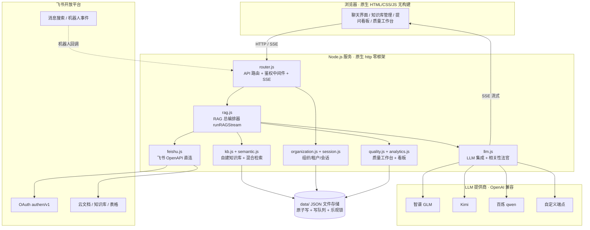

# 飞书大脑（Feishu Brain）技术架构文档

本文档面向技术读者，完整描述系统的定位、架构、核心链路、模块划分与关键技术决策，也可作为维护者自我回顾的技术底稿。工程红线与验收流程见 [AGENTS.md](../AGENTS.md) 与 [工程质量与商用发布规范](工程质量与商用发布规范.md)，检索质量的实测过程见 [关键升级与优化](关键升级与优化.md)。

## 1. 系统定位

飞书大脑是一个部署在企业内部的 RAG 知识问答系统：用户用飞书账号 OAuth 登录，以本人权限实时检索飞书文档、表格与聊天记录，叠加自建上传知识库的混合检索，由大模型生成带块级引用溯源的回答。

系统刻意划定的边界：

- 是**按提问人权限检索实时企业事实的可核验问答**，不是 FAQ 机器人，也不是离线知识库导出工具
- 飞书侧数据不做离线索引、不落地；只有用户主动上传的自建知识库才建本地索引
- 不缓存最终答案与生产检索结果；没有隐藏兜底 LLM Key，未配置 Key 就明确提示

## 2. 设计原则

| 原则 | 含义 | 对应机制 |
|---|---|---|
| 权限不复制 | 权限只存在于飞书，系统不做第二份权限副本 | 全程 user_access_token 实时检索 |
| 事实不缓存 | 答案与检索结果不可缓存，避免陈旧事实 | 缓存红黑榜（见第 7 节） |
| Fail-closed | 宁可返回空结果与明确降级说明，不硬塞低质证据 | 法官不可用时显式降级；空召回给兜底卡 |
| 决策可证伪 | 每个检索参数有基线数据，改动走对照验证 | 质量工作台 + 金标回归 + 门禁测试 |
| 零重型依赖 | 能用平台能力不引第三方库 | 唯一 npm 依赖 pdfjs-dist；零框架前后端 |

## 3. 总体架构

存储层为纯 JSON 文件（`data/` 目录）：配置、会话、知识库索引、组织、质量案例、分析数据各自独立文件，统一采用「临时文件 + rename 原子写、按归属串行的写队列、revision 乐观锁」保证一致性。这是单机部署下的刻意选择，多实例水平扩展时演进为共享存储（见第 10 节）。

## 4. 一次提问的完整生命周期

`runRAGStream` 是一个异步生成器，SSE 端点逐事件转发前端。阶段与事件：

| 阶段 | 做什么 | SSE 事件 |
|---|---|---|
| 0 前置分流 | 身份类问题走固定介绍；未填 Key 提示；粘贴飞书链接直接定位该篇 | about / error |
| 1 查询理解 | 多轮追问改写（检索用改写、展示用原话）；查询规划输出关键词/纠错/扩展；笼统问题澄清反问 | status |
| 2 三路并行召回 | 飞书文档线（云盘+wiki 双搜索、多查询轮询合并）；自建 KB 线（BM25+向量 RRF）；消息线（真人过滤+上下文窗口） | status |
| 3 合并候选池 | 链接文档 > 本地 KB > 消息 > 飞书搜索，token 去重；零召回走意图分流 | status / noresult |
| 4 读取正文 | 远程可读类型按 readPool 预算；状态类问题保留新鲜度席位；正文级语料纠错补搜 | status |
| 5 向量粗排 | 结构感知切块（Q&A/小节独立成块）；块过多先词法粗筛每篇保底一块；动态阈值 | status |
| 6 LLM 相关性法官 | 每篇取最相关块交法官 0~3 分；分批并行 + 决策缓存；状态校准与确定性保护；对抗式复核可选 | status |
| 7 证据选择 | 质量分排序 + 分数断层 + Jaccard 近重复去除，拆主证据与更多相关 | status |
| 8 并行后处理 | 块级深链定位、引用富化（作者/日期/时效）、冲突检测——与生成并行不阻塞首字节 | references / sources |
| 9 流式生成 | 只喂主证据；reasoning 思考流 + token 正文；时效规则（相对日期注解、过期计划措辞） | reasoning / token |
| 10 收尾 | 越界角标清理、置信度分级、案例沉淀、落库 | confidence / conflict / answerFinal / done |

## 5. 模块划分

| 模块 | 职责 |
|---|---|
| index.js | 零框架 HTTP 服务、静态文件、启动调度器 |
| router.js | 全部 API 路由、鉴权中间件（token 提前刷新）、SSE 端点、上传解析编排 |
| rag.js | RAG 总编排器与全部检索策略内部函数 |
| feishu.js | 飞书 OpenAPI 直连：双路搜索、文档/表格读取、块级深链、消息搜索、导出与代发 |
| kb.js | 个人/组织知识库：隔离存储、切块索引、增量更新、混合检索、写队列 |
| semantic.js | 结构感知切块、向量/词法双路打分、rankDocs 重排主流程 |
| llm.js | LLM 集成：流式对话、带引用 prompt、11 种小模型调用、法官分批与决策缓存 |
| query-planner.js | 语料驱动查询规划：近似实体发现、标题词干、状态题核心查询 |
| evidence.js | 证据自适应选取：主证据与更多相关拆分 |
| quality.js | 质量工作台：案例沉淀、人工金标、指标与参数建议 |
| organization.js | 租户与角色模型：tenant_key 边界、Owner/管理员/成员 |
| auth.js / session.js | 飞书 OAuth（state 签名、token 刷新）、内存+文件持久会话 |
| store.js | 对话存储（IDOR 校验）与检索参数默认值 |
| parse.js / mineru.js | 零依赖 Office/PDF 解析 / 本机 MinerU 适配（仅回环地址） |
| analytics.js / scheduler.js / tasks.js | 提问看板 / 定时追踪调度 / 任务管理 |
| feishubot.js | 机器人事件：AES 解密、按发消息人登录态检索、多轮记忆 |
| providers.js / embedcache.js / wishes.js / env.js | 厂商目录 / embedding 与决策缓存 / 反馈收集 / 环境加载 |

## 6. 关键技术决策与权衡

这一节记录「问题、备选、选择、代价」，是维护者最需要回顾的部分。

### 6.1 飞书数据不建离线索引

- 问题：知识库问答的常规做法是把文档全量导出、切片、建向量库，权限与新鲜度都会失真——没有权限的人可能问出答案，索引永远滞后于文档与群内结论。
- 选择：飞书侧数据每次用提问人 user_access_token 实时搜索读取，权限在读取步骤被飞书天然强制；只有用户主动上传的自有资料才建本地索引。
- 代价：受飞书搜索 API 能力边界约束（无语义搜索、候选存在漂移），延迟里包含实时读取。这是「安全与新鲜度优先」下接受的成本，缓解手段是多查询召回与读池预算。

### 6.2 从 lark-cli 封装到 OpenAPI 直连

- 早期版本通过 lark-cli 子进程完成搜索与读文档，依赖外部工具链与凭证目录。
- 重写为直连 OpenAPI 后：去除子进程与环境依赖，凭证进会话，接口调用可编排（并行、轮询合并、块级遍历），并解锁了 lark-cli 未封装的能力（块深链、消息上下文窗口、以本人身份发消息）。

### 6.3 两段式精排：向量粗排 + LLM 相关性法官

- 实测发现向量相似度在 0.55 附近相关/无关样本重叠，单一向量阈值无法干净切分；纯 LLM 判全部候选成本高。
- 选择：向量粗排负责低成本缩小范围（结构感知切块 + 动态阈值 max(0.40, 最高分比例)），LLM 法官对每篇最相关块做 0~3 分精判（分批并行 + 决策缓存），状态类问题再叠加确定性校准（局部缺失降权、明确状态保护）。
- 代价与边界：法官准确率约 90%~95%，2 分边界档引入可选对抗式复核（默认关，弱金标下显示伤召回）；法官服务不可用时显式降级到向量阈值结果并明说，不伪造分数。

### 6.4 自建库混合检索与暴力余弦

- BM25（CJK 一元+二元分词）与向量余弦各取长处，RRF(K=60) 融合，无 embedding Key 时降级纯 BM25。
- 当前暴力余弦在万级 chunk 内为几十到百毫秒，满足单机规模；十万级 chunk 是引入 ANN 向量库的预设拐点，不为未到的规模提前引入复杂度。

### 6.5 零框架与单依赖

- 后端原生 http 模块、前端原生三件套、测试零依赖（node:assert）。唯一 npm 生产依赖是 pdfjs-dist（仅解析文本型 PDF 时惰性加载）。
- 动机：部署面最小（企业内网机器 clone 即跑）、依赖审计面最小、解析层（Office 用内置 zlib 手写 ZIP+XML）完全可控。
- 代价：路由、SSE 解析、ZIP 解析等都要自己写并配测试；换来的是对这些关键路径行为的完全掌握。

### 6.6 缓存红黑榜

| 允许缓存 | 禁止缓存 |
|---|---|
| embedding（端点+模型+内容 hash，LRU 2 万条） | 最终答案 |
| token（按官方有效期，提前 5 分钟刷新） | 生产飞书检索结果 |
| 模型决策（查询规划/法官，带 TTL + 版本 + epoch，可定向失效） | 固定问答的生成过程 |

点踩反馈提升 epoch 使相关决策缓存立即失效，保证反馈闭环能改变后续行为。

## 7. 权限与安全模型

- 登录：飞书 OAuth，authorize 显式请求 20+ 精确 user scope，state 经 HMAC-SHA256 签名防 CSRF。
- 检索：全部走 user_access_token，系统内不存在能绕过本人权限的检索路径；机器人问答同样按发消息人的登录态检索。
- 隔离：对话按 ownerOpenId 全接口 IDOR 校验；知识库按 openId（个人）/tenant_key（组织）物理分文件；质量案例双向过滤。
- 密钥：用户自填 LLM Key 仅存服务端会话内存，重启/登出即失效，GET /api/config 只返回 hasKey；组织写操作非管理员 403；MinerU 仅允许 127.0.0.1 防文件出网。

## 8. 质量工程与评测

- 自动沉淀：每次真实检索记录候选轨迹、向量分、法官分、最终证据与用户反馈。
- 人工金标：答案 4 档 + 候选 3 档标注；达到门槛（≥30 案例、≥100 候选）自动计算 Precision / Recall / F1 并网格搜索参数建议，只建议不自动改线上。
- 回归防线：真实失败案例进入 retrieval-gold.test.js 金标回归；no-case-hardcode.test.js 扫描生产代码，出现具体业务专名即失败。
- 实测文化：阈值 0.40 为标定结果而非惯例值；误报治理有 13 例到 0 的多维审计记录；时间敏感断言使用相对日期生成（绝对日期会形成时间炸弹，此教训已写进测试）。

## 9. 技术栈清单

| 层 | 技术 |
|---|---|
| 运行时 | Node.js ≥ 18，CommonJS |
| HTTP | 原生 http 模块（零框架），SSE 流式 |
| 前端 | 原生 HTML/CSS/JS，无构建 |
| LLM | OpenAI 兼容协议：智谱 GLM-4-Air/GLM-5.2、Kimi、百炼 qwen-plus、自定义端点；embedding 与对话厂商解耦 |
| 检索 | BM25 + 余弦向量 + RRF；结构感知切块；LLM 法官精排 |
| 飞书 | OAuth v1、云盘/wiki 双搜索、docx blocks、sheet 读取、消息搜索、applink 深链、事件回调 |
| 解析 | 内置 zlib 手写 Office 解析、pdfjs-dist、本机 MinerU、OCR API 四级降级 |
| 存储 | JSON 文件（原子写 + 写队列 + revision 乐观锁） |
| 测试 | node:assert 零依赖，28 个测试文件 + 真实链路金标脚本 |
| 部署 | Docker / docker-compose / 裸机 npm start |

## 10. 已知边界与演进路线

当前为技术基线而非商用达标成品，如实记录：

- 飞书在线搜索存在候选漂移，「最新资料稳定召回」未达自设商用门槛
- 人工金标数量不足，参数建议尚未常态触发
- 单机 JSON 存储，多实例需共享存储演进；向量检索规模化时引入 ANN
- 人工发布固定问答（PublishedAnswer）数据模型未实现

演进优先级：金标集扩充与 CI 化评测、检索延迟压缩、ANN 与共享存储、飞书 ISV 商店应用化。
